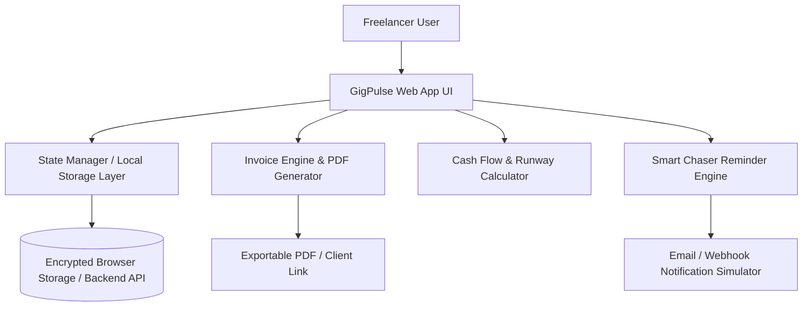

# GigPulse — Product Blueprint & Master Implementation Guide
*The Financial Co-Pilot and Cash-Flow Operating System for Modern Freelancers*

---

## 1. Executive Summary & The "Big Idea"

### The Problem
Over 70% of freelancers and independent contractors suffer from chronic cash flow instability and late client payments. 
- Freelancers are master craftspeople (developers, designers, video editors, consultants), but **terrible accountants**.
- Existing tools (like QuickBooks or SAP) are bloated, expensive, and built for traditional corporations.
- Chasing clients for unpaid invoices is awkward, stressful, and wastes hours every week.
- Traditional invoicing software doesn't forecast future cash flow or tell the freelancer when they are about to run out of money ("feast or famine" cycle).

### The Solution: GigPulse
**GigPulse** is a lightweight, high-aesthetic financial dashboard specifically tailored for freelancers. It does three critical jobs:
1. **Automated "Chaser" Engine:** Auto-schedules polite, escalating payment reminders via email/WhatsApp before and after due dates so freelancers never have to send awkward messages.
2. **Predictive Cash Flow & Runway Pulse:** Visualizes guaranteed income vs. pending invoices vs. monthly living expenses to calculate the freelancer's exact "Runway" in days.
3. **Client Reliability Rating:** Automatically scores clients (e.g. *Grade A: Fast Payer (avg 2 days)* vs. *Grade D: High Risk (avg 28 days late)*) to prevent freelancers from taking bad gigs.

---

## 2. Hackathon Scoring Rubric Mapping (100% Target)

| Rubric Criteria | Weight | How GigPulse Wins This Category |
| :--- | :--- | :--- |
| **Technical Execution** | **25%** | Fully working responsive web app, modular clean architecture, dynamic state management, live invoice generator, real-time analytics graphs, and email reminder preview simulator. |
| **Innovation & UX** | **25%** | Ultra-modern dark-mode fintech aesthetic (Stripe + Linear vibe), micro-animations, instant "1-Click Client Onboarding", and interactive visual cash-flow forecasting. |
| **Business & Finance** | **25%** | High-margin SaaS model ($9/month Pro tier), clear Unit Economics, Total Addressable Market (TAM: 73M US freelancers, 1.5B global), and expansion roadmap into Invoice Factoring (1.5% fee on instant payout). |
| **Communication** | **25%** | Bulletproof 5-minute pitch video script with precise timestamps covering Problem, Tech Architecture, Live Interactive Demo, and Scalability. |

---

## 3. Recommended Tech Stack

To build fast, ensure maximum visual wow-factor, and guarantee zero deployment errors, we use:

- **Frontend Core:** React 18 / Vite + TypeScript (ultra-fast, modern, typed).
- **Styling & Aesthetics:** Modern Tailwind CSS with customized HSL fintech tokens (Deep Slate `#090D16`, Emerald Green `#10B981`, Electric Indigo `#6366F1`) + Framer Motion for micro-interactions.
- **Visuals & Charts:** Recharts or Chart.js (interactive cash flow wave charts, donut expense breakdowns, client payment speed bars).
- **Icons & UI Kit:** Lucide React icons (sleek, minimalist icons).
- **Data Persistence:** LocalStorage / IndexedDB with pre-loaded mock seed toggle for instant, seamless judge demonstration (no broken API keys during live demos).
- **PDF Generation:** `@react-pdf/renderer` or `html2pdf.js` for instant downloadable client invoices.

---

## 4. Core Features Breakdown (The Hackathon MVP)

### Feature 1: The "Pulse" Dashboard (Main Command Center)
- **KPI Metrics Cards:**
  - *Cash in Hand* (Liquid funds available).
  - *Pending Invoices* (Expected within 30 days).
  - *Overdue / At Risk* (Alert indicator with days past due).
  - *Financial Runway* (e.g., "47 Days Covered" based on recurring expenses).
- **Cash Flow Forecast Curve:** An interactive 6-month projected income chart showing baseline expenses vs. expected invoice clearances.

### Feature 2: Smart Invoice & Milestone Manager
- Quick invoice creation form (Client name, hourly/project rate, issue date, due date).
- Status tags: `Draft`, `Sent`, `Due Soon`, `Paid`, `Overdue`.
- One-click PDF download & shareable client payment link preview.

### Feature 3: Automated Payment "Chaser" (The Killer Feature)
- Preview modal of the automated reminder sequence:
  - **T-3 Days:** "Friendly reminder: Invoice #104 is due this Friday."
  - **Due Date:** "Invoice #104 is due today. Here is the direct link."
  - **T+3 Days Overdue:** "Gentle check-in regarding overdue payment."
  - **T+7 Days Overdue:** "Formal notice: 2% late fee applicable."
- Toggleable frequency settings and tone-of-voice selector (*Casual*, *Professional*, *Strict*).

### Feature 4: Client Health & Trust Scorecard
- Table listing active clients with payment history.
- Average days to pay metric (e.g., "Acme Studio: 4 days avg", "Crypto Startup: 34 days avg").
- "Risk Badge" helping freelancers know which clients require upfront deposits.

---

## 5. System Architecture & Data Model



### Core Data Schema (TypeScript Interfaces)

```typescript
export interface Client {
  id: string;
  name: string;
  company: string;
  email: string;
  paymentReliability: 'Fast (1-3d)' | 'Average (4-14d)' | 'Slow (15d+)';
  totalBilled: number;
}

export interface Invoice {
  id: string;
  invoiceNumber: string;
  clientId: string;
  clientName: string;
  amount: number;
  issueDate: string;
  dueDate: string;
  status: 'draft' | 'sent' | 'paid' | 'overdue';
  items: { description: string; hours?: number; rate?: number; amount: number }[];
  reminderTone: 'friendly' | 'professional' | 'firm';
}

export interface CashFlowSettings {
  monthlyLivingExpenses: number;
  currentCashBalance: number;
  taxReserveRate: number; // e.g., 25%
}
```

---

## 6. Business & Monetization Model (Judge Winning Strategy)

1. **Freemium Tier ($0 / month):**
   - Up to 3 active clients.
   - Basic invoice creation and manual reminders.
2. **GigPulse Pro Tier ($9 / month or $89 / year):**
   - Unlimited clients and projects.
   - Automated email & SMS reminder sequences.
   - Advanced Cash-Flow & Tax Runway Forecasting.
   - Custom branding on invoices (remove "Powered by GigPulse").
3. **Future FinTech Revenue Stream (GigPulse Instant Pay):**
   - Offer invoice factoring: Freelancers can get paid **instantly** on approved client invoices for a small 1.5% - 2.5% factoring fee, while GigPulse collects from the client.

---

## 7. 5-Minute Video Pitch Script & Structure

| Time | Segment | What to Show on Screen | What to Say (Script Outline) |
| :---: | :--- | :--- | :--- |
| **0:00 - 0:45** | **The Problem** | Freelancer struggling with spreadsheet / unpaid bills meme | "Freelancers lose billions each year to late payments. They are great at creative work, but dread chasing invoices." |
| **0:45 - 1:30** | **The Solution & Architecture** | Architecture diagram + Tech Stack badges | "Introducing GigPulse: Built with React, TypeScript, and modern predictive analytics to automate cash collection." |
| **1:30 - 3:15** | **Live Working Demo** | Screen share of GigPulse dashboard | 1. Show live dashboard metrics and the 6-month Runway curve.<br>2. Create a new invoice in 15 seconds.<br>3. Trigger the Automated Chaser sequence.<br>4. Inspect the Client Risk Scorecard. |
| **3:15 - 4:00** | **Business Model & TAM** | Pricing slide & TAM breakdown | "With 73M US freelancers, reaching just 10,000 paying users at $9/mo creates a $1M+ ARR business." |
| **4:00 - 5:00** | **Scalability & Future Vision** | Cloud architecture & FinTech expansion roadmap | "Designed with modular REST/GraphQL APIs, ready for bank sync via Plaid and instant invoice financing." |

---

## 8. Implementation Steps & Milestones

1. **Phase 1: Project Scaffolding & Design System**
   - Setup React + Vite + TypeScript.
   - Configure modern dark/light fintech theme and layout structure.
2. **Phase 2: Dashboard & Analytical Charts**
   - Build metrics summary cards (Cash, Pending, Overdue, Runway).
   - Implement the interactive cash flow forecast graph.
3. **Phase 3: Invoicing & Smart Chaser Flow**
   - Build invoice creation modal, items calculation, and PDF exporter.
   - Build the interactive automated reminder preview system.
4. **Phase 4: Client Health Rating & Polish**
   - Build client management table with reliability scoring.
   - Add sample demo data toggle for a flawless presentation.
5. **Phase 5: Pitch Video Recording Preparation**
   - Final review against rubric and delivery of presentation script.
